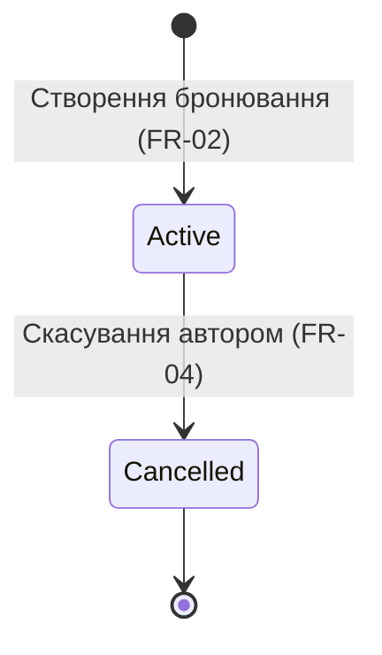
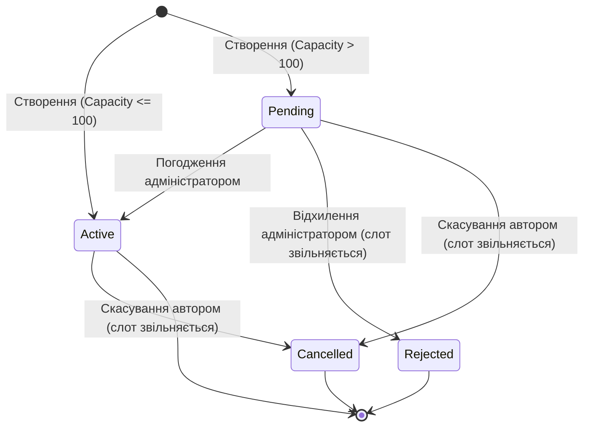
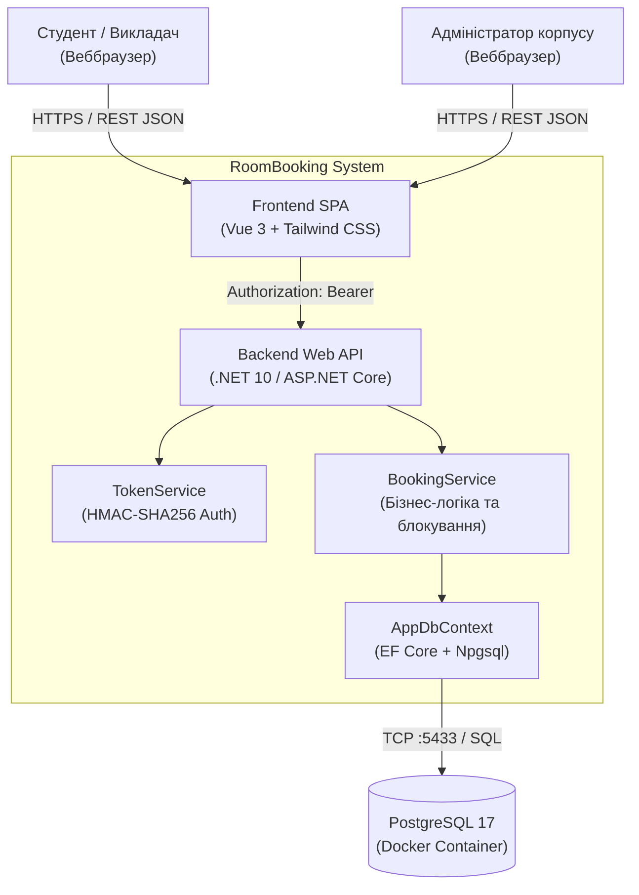

# Звіт із групової лабораторної роботи

## Проєкт: «RoomBooking — Сервіс бронювання університетських аудиторій»

- **Навчальний заклад:** Київський національний університет імені Тараса Шевченка, Факультет комп'ютерних наук та кібернетики
- **Група:** ШІ-1
- **Команда:**
  - **Учасник 1:** Ковальчук Юрій Володимирович (GitHub: `https://github.com/Ura3535`) — Tech Lead, Backend (.NET 10), БД PostgreSQL, CI/CD
  - **Учасник 2:** Северина Катерина (GitHub: `https://github.com/Kateroook`) — QA/Тестування, Аналітика та інцидент-менеджмент

---

## Навігатор по матеріалах проєкту

- **Репозиторій та випуски (GitHub):** [Ura3535/room-booking-system](https://github.com/Ura3535/room-booking-system) • Релізи: [v1.0](https://github.com/Ura3535/room-booking-system/releases/tag/v1.0) | [v2.0](https://github.com/Ura3535/room-booking-system/releases/tag/v2.0)
- **Управління задачами (Jira):** Проєкт `KAN` («Лаба з КРПП») — задачі `KAN-4` – `KAN-14`

| Розділ матеріалів            | Посилання (навігація)                                                                                                                                               | Короткий зміст                                                                                         |
| :--------------------------- | :------------------------------------------------------------------------------------------------------------------------------------------------------------------ | :----------------------------------------------------------------------------------------------------- |
| **Командна угода**           | [1. Організація команди та командна угода](#1-організація-команди-та-командна-угода)                                                                                | Склад, ролі, Kanban-процес, DoD, огляди та ретроспективи                                               |
| **Вимоги й план**            | [2. Вимоги, моделі та планування](#2-вимоги-моделі-та-планування)                                                                                                   | Межі продукту, беклог `FR-01`–`FR-04` і `CR-01`, NFR, моделі станів, таблиця простежуваності           |
| **Архітектура та ADR**       | [3. Архітектура та архітектурні рішення (ADR)](#3-архітектура-та-архітектурні-рішення-adr)                                                                          | C4-схеми, контракти REST API, `ADR-001` (`FOR UPDATE`), `ADR-002` (HMAC-токен) та їх перегляд у `v2.0` |
| **Репозиторій, тести та CI** | [4. Код-рев'ю, тестування та CI/CD](#4-код-ревю-тестування-та-cicd) • [GitHub Actions](https://github.com/Ura3535/room-booking-system/actions)                      | Правила Git, історія рев'ю та merge-конфлікту, матриця тестів (`RoomBooking.Tests`), CI-пайплайн       |
| **Ризики та інцидент**       | [5. Управління ризиками та навчальний інцидент](#5-управління-ризиками-та-навчальний-інцидент)                                                                      | Реєстр 5 ризиків, хронологія збою БД (`KAN-11`), перевірка гіпотез, відновлення та фікс (`KAN-14`)     |
| **Модифікація `v2.0`**       | [6. Модифікація та еволюція системи до v2.0](#6-модифікація-та-еволюція-системи-до-v20) • [SQL-міграція](backend/RoomBooking.Api/migrations/v1_to_v2_migration.sql) | Аналіз впливу погодження залів >100 місць, рефакторинг, міграція даних та умови відкату                |
| **Передавання та внесок**    | [7. Передавання проєкту та особистий внесок](#7-передавання-проєкту-та-особистий-внесок) • [README.md](./README.md)                                                 | Інструкція розгортання і відновлення з бекапу, протокол перевірки, таблиця внеску учасників            |

---

## 1. Організація команди та командна угода

### 1.1. Методологія та координація

Для виконання проєкту обрано адаптований **Kanban** з елементами ітеративного планування (розбиття на два функціональні випуски `v1.0` і `v2.0` та 7 контрольних точок).

- **Обґрунтування вибору:** невеликий склад команди (2 учасники), короткі цикли розробки та необхідність гнучкого реагування на зміну вимог у `v2.0` і навчальний інцидент без накладних витрат на формальні спринти.
- **Робочий процес на дошці Jira:** `To Do` → `In Progress` → `Review` → `Done`. Блокування задач позначаються прапорцем (`Flag`) із фіксацією причини в коментарях.
- **Канали зв'язку та ухвалення рішень:** оперативна координація через месенджер (Telegram) та асинхронні коментарі в Pull Request / Jira; архітектурні рішення ухвалюються консенсусом і фіксуються в ADR.
- **Допомога при блокуванні:** якщо задача заблокована понад 4 години, виконавець позначає її на дошці, і другий учасник підключається у форматі парного програмування або спільного рев'ю.

### 1.2. Розподіл відповідальності

- **Архітектура, бекенд-логіка, схема БД та CI/CD:** Ковальчук Юрій
- **Вимоги, тестування та координація інциденту:** Северина Катерина
- **Взаємне код-рев'ю:** бажане (але не необхідне) для кожного Pull Request перед злиттям у гілку `main`.

### 1.3. Definition of Done (DoD)

Задача вважається завершеною (`Done`), якщо виконано всі умови:

1. Код реалізовано в окремій короткоживучій гілці з ключем задачі Jira в назві.
2. Опціонально пройдено код-рев'ю іншим учасником команди.
3. Усі автоматичні перевірки в GitHub Actions CI (`dotnet build`, `dotnet test`) завершилися успішно (зелений статус).
4. Оновлено пов'язану документацію/схеми, а картку в Jira переведено в `Done` із посиланням на PR.

### 1.4. Огляди результатів та ретроспективи

- **Огляд 1 (після релізу `v1.0`):** продемонстровано повний цикл бронювання на локальному стенді. **Висновок ретроспективи 1:** ручне оновлення схеми БД та відсутність діагностичного ендпоінту ускладнюють виявлення збоїв підключення. **Дія:** додати ендпоінт `/health` та структуроване логування з `CorrelationId` (відповідальний: Ковальчук Ю., реалізовано в `KAN-14`).
- **Огляд 2 (після релізу `v2.0`):** перевірено міграцію даних `v1.0 → v2.0` та погодження великих аудиторій адміністратором. **Результат попередньої дії:** `/health` та логування успішно допомогли діагностувати збій під час навчального інциденту та міграції. **Висновок ретроспективи 2:** SQL-міграції слід обов'язково запускати перед стартом нової версії API, що зафіксовано в інструкції передавання `README.md` (відповідальний: _Северина Катерина_).

---

## 2. Вимоги, моделі та планування

### 2.1. Опис продукту

- **Проблема:** відсутність єдиного прозорого інструменту для бронювання університетських аудиторій призводить до накладок у розкладі та конфліктів під час організації консультацій, семінарів і студентських заходів.
- **Користувачі та зацікавлені сторони:**
  - _Студенти та викладачі (звичайні користувачі):_ пошук вільних аудиторій, бронювання слотів, перегляд і скасування власних записів.
  - _Адміністратор навчального корпусу (роль у `v2.0`):_ контроль та погодження заявок на великі аудиторії місткістю понад 100 місць.
- **Межі системи:** система працює на підготовлених навчальних облікових записах (`student1`, `student2`, `admin`) із токенною автентифікацією. Самостійна реєстрація, відновлення пароля та інтеграція із зовнішніми SSO не входять до обсягу роботи. Часова зона для введення та відображення — **`Europe/Kyiv`** (зберігання в БД у форматі `UTC`, ISO 8601).

### 2.2. Беклог та критерії приймання (Jira проєкт `KAN`)

| Ключ Jira  | Вимога / Тип    | Опис та критерії приймання (Позитивний / Негативний / Граничний)                                                                                                                                                                                                                                                                                                                                                                                                              | Версія |
| :--------- | :-------------- | :---------------------------------------------------------------------------------------------------------------------------------------------------------------------------------------------------------------------------------------------------------------------------------------------------------------------------------------------------------------------------------------------------------------------------------------------------------------------------- | :----- |
| **KAN-6**  | `FR-01` (Story) | **Перегляд аудиторій і доступності на інтервал `[start, end)`** • _Позитивний:_ вільна аудиторія на заданий слот повертає `isAvailable: true`. • _Граничний:_ суміжний запит `[11:30, 13:00)` після зайнятого `[10:00, 11:30)` визначає аудиторію як вільну. • _Негативний:_ при `start >= end` API повертає `400 Bad Request`.                                                                                                                                      | `v1.0` |
| **KAN-7**  | `FR-02` (Story) | **Створення бронювання** • _Позитивний:_ валідний запит створює запис зі статусом `Active` (`201 Created`), дані зберігаються після перезапуску контейнера БД. • _Негативний:_ перетин із зайнятим слотом повертає `409 Conflict`. • _Конкурентний:_ із двох паралельних запитів на один слот успішним є лише один (`201`), інший отримує `409 Conflict`.                                                                                                            | `v1.0` |
| **KAN-8**  | `FR-03` (Story) | **Перегляд власних бронювань** • _Позитивний:_ користувач бачить перелік усіх своїх записів та їхні поточні статуси. • _Негативний:_ записи інших користувачів не повертаються у вибірці.                                                                                                                                                                                                                                                                               | `v1.0` |
| **KAN-9**  | `FR-04` (Story) | **Скасування власного бронювання** • _Позитивний:_ автор скасовує свій запис → статус `Cancelled`, слот звільняється. • _Негативний:_ спроба іншого користувача скасувати чуже бронювання відхиляється на сервері (`403 Forbidden`).                                                                                                                                                                                                                                    | `v1.0` |
| **KAN-10** | Bug             | Виправлення та фіксація правил суміжності інтервалів `[start, end)` і вирішення конфлікту злиття у спільному файлі UI.                                                                                                                                                                                                                                                                                                                                                        | `v1.0` |
| **KAN-11** | Task            | Проведення навчального інциденту (відмова БД PostgreSQL), збір метрик та післяінцидентний розбір.                                                                                                                                                                                                                                                                                                                                                                             | `v1.0` |
| **KAN-14** | Task            | Коригувальна дія: додавання ендпоінту `/health`, логування з `CorrelationId` та обробки `503 Service Unavailable`.                                                                                                                                                                                                                                                                                                                                                            | `v1.0` |
| **KAN-12** | `CR-01` (Story) | **Погодження великих аудиторій (`> 100` місць) адміністратором** • _Позитивний:_ заявка на зал `> 100` місць отримує статус `Pending` і блокує слот; адміністратор переводить її в `Active` або `Rejected` (звільняючи слот). • _Граничний:_ аудиторія рівно на `100` місць бронюється одразу в `Active`. • _Негативний:_ звичайний студент отримує `403 Forbidden` при спробі погодити заявку; повторне рішення по вже опрацьованій заявці повертає `409 Conflict`. | `v2.0` |
| **KAN-13** | Task            | Міграція даних `v1.0 → v2.0` зі збереженням існуючих записів, регресійне тестування та пакет передавання.                                                                                                                                                                                                                                                                                                                                                                     | `v2.0` |

### 2.3. Перевірювані вимоги якості (NFR)

1. **Контроль доступу (Security / Access Control):**
   - _Умова:_ будь-який запит на створення/скасування бронювання без валідного підписаного HMAC-SHA256 токена або спроба скасування чужого запису / погодження заявки звичайним користувачем (`Role = Student`).
   - _Поріг:_ 100% несанкціонованих запитів відхиляються на рівні серверного API зі статусами `401 Unauthorized` або `403 Forbidden`.
   - _Спосіб перевірки:_ автоматизовані тести `LargeRoomApproval_EnforcesAdminRoleAndPreventsDoubleReview` та перевірка через Swagger/REST-клієнт.
2. **Збереження та цілісність даних (Data Persistence & Concurrency):**
   - _Умова:_ перезапуск контейнера `roombooking_db` або одночасне надходження двох конкурентних HTTP-запитів на бронювання одного вільного слоту.
   - _Поріг:_ 0 втрачених підтверджених записів після перезапуску; рівно 1 створене бронювання при конкурентному запиті.
   - _Спосіб перевірки:_ інтеграційний тест `ParallelBookingRequests_OnlyOneSucceeds` та перевірка персистентності через Docker volume `pgdata`.
3. **Продуктивність та відтворюваність запуску (Performance & Reproducibility):**
   - _Умова:_ локальне тестове середовище (Docker PostgreSQL 17 + .NET 10 Web API), серія зі 100 послідовних запитів `GET /api/rooms` після прогріву.
   - _Поріг:_ час відповіді `p95 <= 150 мс`; розгортання бази даних та проходження тестів із чистого середовища виконується згідно з інструкцією в `README.md`.
   - _Спосіб перевірки:_ вимірювання тривалості запитів у middleware логування (`Duration ms`) та практична перевірка передавання.

### 2.4. Модель предметної області та словник термінів

- **Сутності та зв'язки:**
  - `AppUser` (`Id`, `Username`, `Password`, `FullName`, `Role: Student | Admin`) — зареєстрований навчальний користувач. Один користувач може створити багато бронювань (`1:N`) та, якщо має роль `Admin`, погодити багато заявок (`1:N`).
  - `Room` (`Id`, `Name`, `Building`, `Capacity`, `Equipment`) — університетська аудиторія. Одна аудиторія може мати багато бронювань у різні часові інтервали (`1:N`).
  - `Booking` (`Id`, `RoomId`, `UserId`, `StartTime`, `EndTime`, `Purpose`, `Status`, `CreatedAt`, `ReviewedByUserId`, `ReviewedAt`, `ReviewComment`) — запис про резервування аудиторії.
- **Словник термінів:**
  - _Слот `[start, end)`_ — напіввідкритий часовий інтервал у зоні `Europe/Kyiv` (зберігається в `UTC`), де момент `end` одного бронювання може збігатися з моментом `start` наступного (суміжність дозволена).
  - _Велика аудиторія_ — аудиторія, місткість якої строго перевищує `100` місць (`Capacity > 100`), що вимагає адміністративного погодження у `v2.0`.

### 2.5. Модель станів бронювання

**Версія `v1.0`:**

**Версія `v2.0` (після додавання погодження великих аудиторій):**

### 2.6. Матриця простежуваності

| Вимога                                   | Задача Jira        | Гілка / Pull Request               | Автоматична перевірка (Тест / CI)                                                                                | Випуск        |
| :--------------------------------------- | :----------------- | :--------------------------------- | :--------------------------------------------------------------------------------------------------------------- | :------------ |
| Інфраструктура та CI                     | `KAN-4`, `KAN-5`   | `main` / CI Workflow               | GitHub Actions `CI Build & Test`                                                                                 | `v1.0`        |
| `FR-01` Пошук аудиторій                  | `KAN-6`, `KAN-10`  | `feat/KAN-6-KAN-9-v1-backend-core` | `ValidateInterval_WorksCorrectly`, `IntervalOverlap_AllowsAdjacent_BlocksPartialOverlap`                         | `v1.0`        |
| `FR-02` Створення бронювання             | `KAN-7`            | `feat/KAN-6-KAN-9-v1-backend-core` | `ParallelBookingRequests_OnlyOneSucceeds`                                                                        | `v1.0`        |
| `FR-03`, `FR-04` Перегляд і скасування   | `KAN-8`, `KAN-9`   | `feat/KAN-6-KAN-9-auth`            | Наскрізний сценарій UI + перевірка статусів                                                                      | `v1.0`        |
| Навчальний інцидент і фікс               | `KAN-11`, `KAN-14` | `fix/KAN-14-incident-healthcheck`  | Перевірка `/health` та `503` при зупинці БД                                                                      | `v1.0` (post) |
| `CR-01` Погодження >100 місць + міграція | `KAN-12`, `KAN-13` | `feat/KAN-12-KAN-13-v2-approval`   | `DetermineInitialStatus_RespectsCapacityThreshold`, `LargeRoomApproval_EnforcesAdminRoleAndPreventsDoubleReview` | `v2.0`        |

---

## 3. Архітектура та архітектурні рішення (ADR)

### 3.1. Контекстна схема та схема компонентів (C4)

### 3.2. Контракт основних операцій API

| Метод та маршрут                          | Вхідні дані                                                     | Успішний результат                                            | Коди помилок                                 | Права доступу             |
| :---------------------------------------- | :-------------------------------------------------------------- | :------------------------------------------------------------ | :------------------------------------------- | :------------------------ |
| `POST /api/auth/login`                    | `{ username, password }`                                        | `200 OK` `{ token, user }`                                    | `401` (невірні дані)                         | Публічний                 |
| `GET /api/rooms?start=&end=`              | Query: `start`, `end` (ISO 8601)                                | `200 OK` список аудиторій з `isAvailable`, `requiresApproval` | `400` (`start >= end`)                       | Публічний / Авторизований |
| `POST /api/bookings`                      | Header `Bearer`, Body `{ roomId, startTime, endTime, purpose }` | `201 Created` об'єкт бронювання (`Active` або `Pending`)      | `400`, `401`, `404`, `409` (конфлікт)        | `Student`, `Admin`        |
| `GET /api/bookings/my`                    | Header `Bearer`                                                 | `200 OK` список бронювань поточного користувача               | `401`                                        | `Student`, `Admin`        |
| `POST /api/bookings/{id}/cancel`          | Header `Bearer`, Path `id`                                      | `200 OK` `{ id, status: "Cancelled" }`                        | `400`, `401`, `403` (чужий запис), `404`     | Власник запису            |
| `GET /api/bookings/pending` _(v2.0)_      | Header `Bearer`                                                 | `200 OK` заявки у стані `Pending`                             | `401`, `403`                                 | Лише `Admin`              |
| `POST /api/bookings/{id}/review` _(v2.0)_ | Header `Bearer`, Body `{ approve, comment }`                    | `200 OK` оновлений статус (`Active` / `Rejected`)             | `401`, `403`, `404`, `409` (вже опрацьовано) | Лише `Admin`              |
| `GET /health` _(KAN-14)_                  | —                                                               | `200 OK` `{ status: "Healthy" }`                              | `503` (БД недоступна)                        | Публічний                 |

### 3.3. Записи архітектурних рішень (ADR)

#### ADR-001: Захист від паралельного бронювання одного слоту (Concurrency Control)

- **Контекст:** Два користувачі можуть одночасно надіслати запит `POST /api/bookings` на одну вільну аудиторію на пересічний час. Звичайна перевірка `AnyAsync()` перед `SaveChangesAsync()` без блокування створює стан гонитви (race condition) і дозволяє подвійне бронювання.
- **Розглянуті варіанти:**
  1. _Рівень ізоляції `Serializable` без явного блокування рядків:_ гарантує відсутність аномалій, але при одночасному записі PostgreSQL викидає виняток серіалізації (`40001`), що потребує складного механізму повторних спроб (retry loop).
  2. _Песимістичне блокування рядка аудиторії (`SELECT ... FOR UPDATE`) у транзакції `ReadCommitted`:_ другий паралельний запит на ту саму аудиторію очікує завершення транзакції першого запиту, після чого бачить уже збережений запис і повертає клієнту детермінований статус `409 Conflict`.
- **Рішення:** Обрано **Варіант 2** (`ReadCommitted` + `SELECT * FROM "Rooms" WHERE "Id" = {roomId} FOR UPDATE`).
- **Наслідки:** (+) Гарантована відсутність подвійного бронювання без винятків `40001`; (–) Незначне послідовне очікування при високій конкуренції за одну й ту саму аудиторію.
- **Умова перегляду:** Якщо навантаження зросте до сотень запитів на секунду на одну аудиторію або система перейде на кілька інстансів БД.
- **Перегляд у `v2.0`:** Рішення **залишається чинним без змін**, оскільки заявки зі статусом `Pending` блокують слот за тією самою перевіркою перетину інтервалів у межах транзакції `FOR UPDATE`.

#### ADR-002: Спрощена токенна автентифікація (HMAC-SHA256 Bearer Token) замість зовнішнього Identity Provider

- **Контекст:** Вимоги передбачають використання підготовлених навчальних облікових записів (`student1`, `student2`, `admin`) і серверну перевірку прав доступу без обов'язкової реєстрації чи OAuth.
- **Розглянуті варіанти:**
  1. _Передача ідентифікатора у відкритому заголовку `X-User-Id`:_ легко підробити на клієнті, не відповідає вимогам перевірки прав.
  2. _Підписаний серверним секретом токен `base64(userId:username:role).hmac_sha256` (`TokenService`):_ не потребує зовнішніх серверів чи складних таблиць сесій, але криптографічно захищає роль і ідентифікатор користувача від підміни.
- **Рішення:** Обрано **Варіант 2**.
- **Наслідки:** (+) Повна автономність, перевірка прав у бекенді (`401`/`403`), збереження сесії в `localStorage`; (–) Відсутність механізму відкликання окремого токена до зміни секретного ключа.
- **Умова перегляду:** При переведенні системи в реальну експлуатацію університету (інтеграція з корпоративним OIDC / Keycloak).
- **Перегляд у `v2.0`:** Рішення **підтверджено як чинне**, оскільки поле `Role` (`Admin` / `Student`) вже зашите в підписаний payload токена і безпосередньо використовується для захисту ендпоінтів `/api/bookings/pending` та `/review`.

---

## 4. Код-рев'ю, тестування та CI/CD

### 4.1. Правила якості коду та історія Git

- **Правила іменування:** гілки називаються за шаблоном `<тип>/<ключ-Jira>-<короткий-опис>` (наприклад, `feat/KAN-6-KAN-9-v1-backend-core`, `fix/KAN-14-incident-healthcheck`); коміти — за специфікацією Conventional Commits із зазначенням ключа задачі.
- **Статичний аналіз та CI (`.github/workflows/ci.yml`):** при кожному `push` та `pull_request` у `main` автоматично піднімається сервіс `postgres:17-alpine`, виконується відновлення залежностей, компіляція в конфігурації `Release` та прогін усіх модульних і інтеграційних тестів `dotnet test RoomBooking.slnx`.
- **Демонстрація життєвого циклу CI та Git:**
  - Зафіксовано контрольований збій CI (невідповідність імені файлу рішення `RoomBooking.sln` → `RoomBooking.slnx` та налаштування рівня ізоляції транзакції) із подальшим виправленням і зеленим білдом.
  - Відпрацьовано вирішення конфлікту злиття у спільному файлі `frontend/src/App.vue` між гілками `feat/KAN-6-KAN-9-v1-frontend` та `fix/KAN-10-adjacent-intervals` зі збереженням актуального UI.
  - Зафіксовано два офіційні теги випусків: **`v1.0`** та **`v2.0`**.

### 4.2. Матриця тестового покриття (`RoomBooking.Tests`)

1. **Модульні тести (`ValidateInterval_WorksCorrectly`, `IntervalOverlap_AllowsAdjacent_BlocksPartialOverlap`):** перевіряють коректність валідації `start < end`, дозвіл суміжних інтервалів `[10:00, 11:00)` і `[11:00, 12:00)` та блокування часткового перетину `[10:30, 11:30)`.
2. **Інтеграційний тест конкурентності (`ParallelBookingRequests_OnlyOneSucceeds`):** запускає два паралельні потоки `Task.WhenAll` на реальній БД PostgreSQL — підтверджено отримання одного статусу `201` та одного `409`.
3. **Регресійні та рольові тести `v2.0` (`DetermineInitialStatus_RespectsCapacityThreshold`, `LargeRoomApproval_EnforcesAdminRoleAndPreventsDoubleReview`):** підтверджують автоматичне створення статусу `Active` для аудиторій `<= 100` місць, `Pending` для `> 100` місць, заборону погодження студентом (`403 Forbidden`) та захист від повторного погодження (`409 Conflict`).

---

## 5. Управління ризиками та навчальний інцидент

### 5.1. Реєстр ризиків проєкту

| ID       | Причина → Подія → Наслідок                                                                                                 | Власник             | Ймов. / Вплив     | Ознаки наближення                                         | Запобіжна дія (статус)                                                                                                  | Резервний план                                                                       |
| :------- | :------------------------------------------------------------------------------------------------------------------------- | :------------------ | :---------------- | :-------------------------------------------------------- | :---------------------------------------------------------------------------------------------------------------------- | :----------------------------------------------------------------------------------- |
| **R-01** | Одночасні запити двох користувачів → стан гонитви → подвійне бронювання аудиторії                                          | Ковальчук Ю.        | Середня / Високий | Помилки `40001` у логах БД або дублікати слотів           | **Виконано:** впроваджено блокування `FOR UPDATE` та тест `ParallelBookingRequests_OnlyOneSucceeds`                     | Ручне скасування дубліката адміністратором у БД                                      |
| **R-02** | Зупинка контейнера PostgreSQL або обрив мережі → недоступність БД → необроблені винятки `500` і втрата довіри користувачів | _Северина Катерина_ | Середня / Високий | Таймаути підключення `NpgsqlException`, відмова `/health` | **Виконано (після інциденту `KAN-14`):** додано middleware перехоплення `NpgsqlException` (`503`) та ендпоінт `/health` | Перезапуск контейнера `docker start roombooking_db` та відновлення з `backup_v1.sql` |
| **R-03** | Несумісна зміна схеми БД при переході на `v2.0` → помилка `42703` при вставці записів → неможливість створити бронювання   | Ковальчук Ю.        | Висока / Високий  | Помилки SQL після оновлення коду API                      | **Виконано:** підготовлено ідемпотентний скрипт `v1_to_v2_migration.sql` та резервну копію `backup_v1.sql`              | Відкат на тег `v1.0` та відновлення дампу БД                                         |
| **R-04** | Конфлікт порту `5432` із системним PostgreSQL на хості розробника → неможливість підняти тестовий контейнер                | Ковальчук Ю.        | Висока / Низький  | Помилка `address already in use` при старті Docker        | **Виконано:** перепризначено зовнішній порт контейнера на `5433:5432` у `docker-compose.yml` та `appsettings.json`      | Зміна порту в змінних середовища конфігурації                                        |
| **R-05** | Помилка в логіці розрахунку часових поясів (UTC vs Kyiv) → зміщення бронювань на 2 години                                  | _Северина Катерина_ | Низька / Середній | Розбіжність між часом у формі UI та записом у БД          | **Виконано:** стандартизовано передачу `DateTimeOffset` (ISO 8601) з явним зміщенням `+02:00` і збереження в `UTC`      | Коригування часової зони на рівні DTO серіалізації                                   |

### 5.2. Звіт про проведення навчального інциденту (Задача `KAN-11`)

- **Постановка експерименту:** у локальному ізольованому середовищі після фіксації версії `v1.0` було виконано контрольовану зупинку контейнера бази даних (`docker stop roombooking_db`) для перевірки стійкості сервісу та процедур діагностики.
- **Розподіл ролей під час інциденту:**
  - _Координатор інциденту:_ _Северина Катерина_
  - _Технічний виконавець:_ Ковальчук Юрій
  - _Відповідальний за інформування (ведення журналу):_ _Северина Катерина_
- **Хронологія інциденту (UTC):**
  - `19:00:10` — Початок впливу: виконано зупинку контейнера `roombooking_db`.
  - `19:00:45` — Виявлення: при спробі створити бронювання користувач отримав помилку збою, у консольному журналі зафіксовано критичний запис:
    `ALERT CorrelationId=8f09c910 DB_UNAVAILABLE POST /api/bookings -> 503 (94 ms)`
  - `19:01:30` — Перевірка гіпотез:
    - _Гіпотеза 1 (невірний рядок підключення / креданшали):_ відхилена, оскільки до `19:00:10` запити виконувалися успішно без зміни конфігурації.
    - _Гіпотеза 2 (недоступність процесу СУБД PostgreSQL):_ підтверджена командою `docker ps` (контейнер `roombooking_db` у стані `Exited`) та перевіркою діагностичного маршруту `GET /health` (повернув `503 Unhealthy`).
  - `19:02:15` — Відновлювальна дія: виконано перезапуск контейнера `docker start roombooking_db`.
  - `19:02:40` — Підтвердження відновлення: запит `GET /health` повернув `200 OK` (`{"status":"Healthy","database":"Connected"}`), тестове створення та перегляд бронювань підтвердили повну збереженість попередніх даних у томі `pgdata`.
- **Післяінцидентний розбір та коригувальні задачі:**
  1. **`KAN-14` (виконано до захисту):** додано ендпоінт `/health` та перехоплення винятків `NpgsqlException` у middleware з поверненням структурованої відповіді `503 Service Unavailable` і `CorrelationId`.
  2. **Подальше покращення (відкрита рекомендація):** налаштування автоматичної політики перезапуску контейнерів (`--restart unless-stopped`) та автоматичного застосування SQL-міграцій під час старту API.

---

## 6. Модифікація та еволюція системи до `v2.0`

### 6.1. Аналіз впливу зміни (Change Request `KAN-12`)

- **Зміст зміни:** впровадження двоетапного життєвого циклу бронювання для аудиторій місткістю понад `100` місць (`Pending` → погодження/відхилення адміністратором).
- **Вплив на компоненти:**
  - _Модель даних та БД:_ додавання колонок `ReviewedByUserId`, `ReviewedAt`, `ReviewComment` до таблиці `Bookings`.
  - _Бізнес-логіка:_ рефакторинг `BookingService` (виділення константи `LargeRoomCapacityThreshold = 100` та методу `DetermineInitialStatus`), додавання методу `ReviewBookingAsync`, розширення `CancelBookingAsync` для підтримки скасування заявок у стані `Pending`.
  - _API та права:_ нові захищені маршрути `GET /api/bookings/pending` та `POST /api/bookings/{id}/review` лише для ролі `Admin`.
  - _UI:_ додавання бейджів потреби погодження на картках великих аудиторій та вкладки «Погодження заявок» для адміністратора.
- **Порівняння стратегій внесення змін:**
  - _Локальна еволюційна зміна (обрано):_ мінімальний ризик, повне збереження накопичених даних `v1.0` через адитивну міграцію `ALTER TABLE ... ADD COLUMN`, низька трудомісткість.
  - _Поступова заміна компонента:_ надлишкова для модульного моноліту такого масштабу.
  - _Повне переписування з нуля:_ невиправдано високий ризик регресії та втрати сумісності даних.

### 6.2. Міграція даних та обмеження відкату

- **Процедура міграції:** перед оновленням створено резервну копію `migrations/backup_v1.sql`, після чого виконано скрипт `backend/RoomBooking.Api/migrations/v1_to_v2_migration.sql`. Усі існуючі записи з `v1.0` зберегли свої ідентифікатори, власників, інтервали та статус `Active` без потреби ретроспективного погодження.
- **Сумісність та обмеження відкату:** схема БД `v2.0` є зворотно сумісною з кодом `v1.0` на рівні читання/запису (оскільки нові колонки є `NULLABLE`), проте у випадку відкату коду на `v1.0` записи, створені у стані `Pending`, не зможуть бути погоджені через старий інтерфейс. Повний безпечний відкат можливий шляхом розгортання тегу `v1.0` разом із відновленням дампу `migrations/backup_v1.sql`.

---

## 7. Передавання проєкту та особистий внесок

### 7.1. Протокол перевірки передавання

- **Інструкція розгортання та відновлення:** винесена в основний файл документації репозиторію [`README.md`](./README.md).
- **Практична перевірка передавання:** інструкцію перевірено в чистому робочому каталозі іншим учасником команди (_Северина Катерина_, середовище: Fedora Linux / VS Code). Усі кроки розгортання контейнера БД, застосування міграції, проходження тестів (`10/10 Passed`), бронювання великої аудиторії та відновлення даних з бекапу підтверджено без помилок.

### 7.2. Таблиця особистого внеску учасників

| Учасник                          | Задачі Jira                                                                        | Ключові зміни в репозиторії                                                               | Код-рев'ю та документація                                        | Роль в інциденті та передаванні                                             |
| :------------------------------- | :--------------------------------------------------------------------------------- | :---------------------------------------------------------------------------------------- | :--------------------------------------------------------------- | :-------------------------------------------------------------------------- |
| **Ковальчук Юрій Володимирович** | `KAN-4`, `KAN-5`, `KAN-6`, `KAN-7`, `KAN-8`, `KAN-9`, `KAN-10`, `KAN-12`, `KAN-14` | Архітектура .NET 10, Vue3, CI/CD GitHub Actions, логування, логіка `v2.0` та міграція SQL | Написання фінального звіту                                       | Технічний виконавець відновлення БД, автор інструкції розгортання           |
| **Северина Катерина**            | `KAN-11`, `KAN-14`                                                                 | Модульні та регресійні тести                                                              | Рев'ю PR, формування беклогу/критеріїв приймання, реєстр ризиків | Координатор інциденту, ведення хронології, контрольна перевірка передавання |
